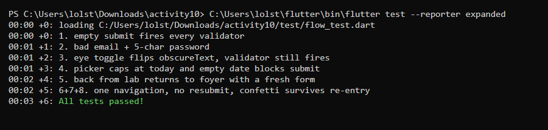
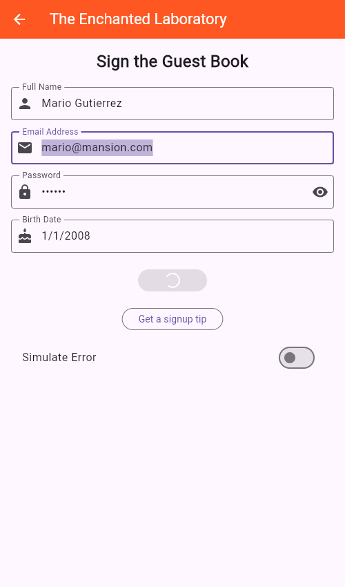

# The Haunted Signup Mansion

My Activity 10 signup form, split into three screens.

## Files

- `lib/main.dart` starts the app.
- `lib/screens/welcome_screen.dart` is the Foyer, with the typing title and the Enter button.
- `lib/screens/signup_screen.dart` is the Lab, with the form, the eye toggle, the date picker and the spinner.
- `lib/screens/success_screen.dart` is the Ballroom, with the name and the confetti.

## How to run

```
flutter pub get
flutter run
flutter test
```

## How it works (in my own words)

**Navigation stack:** The Foyer is always at the bottom. Enter does `push`, so the Lab sits on top of it and back goes home. Join does `pushReplacement`, so the Ballroom takes the Lab's spot and back can't return to the form. "Back to the Foyer" uses `popUntil` to clear everything down to the first screen. When I swapped in plain `push` for the Trapdoor experiment, back from the Ballroom showed the old Lab with my values still in it and the button stuck on the spinner.

**Where state lives and when it dies:** The form's values, the eye toggle, the date and the spinner flag all live in the Lab's `State`. The confetti lives in the Ballroom's `State`. Each one is created when its screen is pushed and thrown away when the screen is popped or replaced, which is why the form is empty every time I come back in.

**Why dispose() matters:** Controllers keep memory and listeners alive until you free them. The Lab disposes its four text controllers and the Ballroom disposes the confetti controller, so going through the mansion over and over doesn't leak anything.

## Screenshots

Test output:



Reversed Trapdoor (push instead of pushReplacement, then back from the Ballroom):



## Bugs I hit

- `pubspec.yaml` asked for Dart 3.13.7 but I have 3.13.4, so the packages wouldn't install. I changed it to `^3.13.0`.
- The old form never disposed its controllers. I added `dispose()`.
- The tip button called `setState` after waiting, without checking `mounted`. I added the check.
